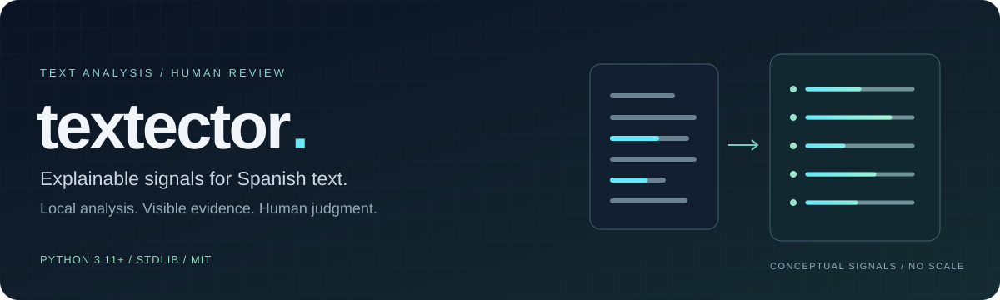
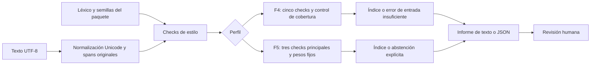

<p align="center"></p>

<p align="center"><a href="README.md">English</a> · <b>Español</b></p>

<p align="center">
  <a href="https://github.com/berniehans/textector/actions/workflows/tests.yml"></a>
  <a href="https://github.com/berniehans/textector/releases/latest"></a>
  
  
  <a href="LICENSE"></a>
</p>

<p align="center"><a href="#inicio-rápido">Inicio rápido</a> · <a href="#cómo-funciona">Arquitectura</a> · <a href="#evidencia-y-límites">Evidencia</a> · <a href="docs/README.md">Documentación</a> · <a href="https://github.com/berniehans/textector/releases/tag/v0.3.1">Descargar 0.3.1</a></p>

**textector** es una CLI local en español que convierte señales de estilo en un **índice heurístico explicable de 0 a 100** (`indice_llm`). Muestra la contribución de cada señal, informa cuando falta evidencia y sirve de apoyo para revisar prosa en español.

> El índice describe estilo. **No es una probabilidad ni una prueba de autoría.** Un índice bajo tampoco demuestra autoría humana. La versión **0.3.1** se publica como prefiltro experimental; su evaluación externa tiene limitaciones relevantes.

## Qué permite examinar

| Capacidad | Qué aporta |
|---|---|
| **Puntuación explicable** | Métricas crudas, señales normalizadas, pesos y contribuciones individuales. |
| **Análisis local** | Biblioteca estándar en ejecución, sin claves de API, descargas de modelos ni llamadas de red durante el análisis. |
| **Cobertura explícita** | F4 exige sus cinco checks; F5 se abstiene si falta cualquiera de sus tres checks principales. |
| **Dos perfiles** | F4 histórico por defecto y F5 experimental, congelado y optativo. |
| **Entradas auditables** | Hashes de semillas, huellas del léxico, procedencia del corpus e informes versionados. |
| **Paquete portable** | Wheel con léxico, configuración del perfil y ambas semillas incluidos. |

## Inicio rápido

Requiere **Python 3.11+**. Instala el wheel publicado directamente desde GitHub Releases:

```bash
python -m pip install "https://github.com/berniehans/textector/releases/download/v0.3.1/textector-0.3.1-py3-none-any.whl"
textector analyze --archivo texto.txt --detallado
textector analyze --archivo texto.txt --json --diagnostico
```

Usa un archivo UTF-8 y conserva sus párrafos y puntuación originales. F4 necesita al menos 10 oraciones válidas, 3 párrafos, 50 tokens y 150 bytes limpios, con los cinco checks disponibles. La [guía de uso](docs/guia-uso.md) explica requisitos y errores. El paquete se distribuye por GitHub Releases; estos comandos no presuponen una publicación en PyPI.

### Ejecutar desde el repositorio

```bash
git clone https://github.com/berniehans/textector.git
cd textector
uv sync --locked
uv run python -B tools/cli.py analyze --archivo corpus/human/h01.txt
```

Salida real del ejemplo `h01.txt` incluido en el repositorio:

```text
indice_llm=15 version=f4-integridad n_disponibles=5 semillas=reales-es
```

El ejemplo muestra el formato del informe, no la precisión de un clasificador de autoría. `--detallado` amplía las contribuciones; `--json` devuelve el informe completo para otras herramientas.

### Otras entradas y perfiles

```bash
# Entrada estándar desde una terminal UTF-8
cat texto.txt | textector analyze --stdin --json

# Perfil experimental congelado; se selecciona explícitamente
textector analyze --archivo texto.txt --metodo f5 --json
```

Elige una sola fuente: `--archivo` o `--stdin`. `--diagnostico` describe únicamente F4 y no se puede combinar con F5. Consulta la [referencia de opciones](docs/guia-uso.md#opciones).

## Cómo funciona



F4 mide **diversidad léxica (MATTR), densidad de clichés, compresión sembrada, variación en la longitud de las oraciones y uniformidad de párrafos**. F5 usa las tres primeras con su propia ponderación fija; el ritmo y los párrafos quedan como auxiliares descriptivos.

| Perfil | Versión de señal | Cobertura e interpretación |
|---|---|---|
| **F4 · predeterminado** | `f4-integridad` | Exige 5/5 checks. Referencia histórica provisional: 31 ± 2; banda inclusiva de abstención 29–33. |
| **F5 · optativo** | `f5-portable-v1` | Exige 3/3 checks principales. Umbral de desarrollo congelado: 15 ± 4; banda inclusiva 11–19. Experimental. |

La versión del paquete `0.3.1` y las versiones de señal identifican cosas distintas. Los índices de F3, F4 y F5 no son intercambiables. Las categorías del diagnóstico conservan `no_concluyente=True`. Las etiquetas internas `humano`/`ia` son categorías de contraste para evaluación, no veredictos de autoría.

Consulta la [arquitectura](docs/arquitectura.md), los [checks de F4](docs/checks.md) y la [definición de F5](docs/validacion-f5-portable.md).

## Evidencia y límites

La evaluación externa de F4 mantuvo sus parámetros fijos y utilizó textos públicos ya existentes. No se generaron muestras IA nuevas para ella.

| Panel externo F4 | Total | Señal de estilo IA | Abstenciones |
|---|---:|---:|---:|
| Libros humanos con versiones digitales anteriores a 2020 | 90 fragmentos, 9 autores | **8 falsos positivos (8,9% del total)** | 19 |
| Cuentos infantiles publicados en español atribuidos a Gemini 1.5 Flash | 200 | 190 | 9 |
| Generaciones literarias españolas de IberAuTexTification | 300 | Ningún caso puntuado | **300: estructura insuficiente** |

Los paneles difieren en género, longitud y formato. Los fragmentos humanos no equivalen a 90 autores independientes. El resultado sobre cuentos infantiles no acredita rendimiento con otros generadores ni narrativa adulta. Véanse [denominadores, cobertura, procedencia y factores de confusión](docs/validacion-externa-v1.md).

**La investigación de F5 para narrativa española se cerró sin promoción.** El cribado de desarrollo no encontró una variante que cumpliera todas las puertas declaradas, y la auditoría no encontró un corpus nuevo apto para confirmación independiente. F5 se conserva como experimento congelado. Consulta el [plan y cierre experimental](docs/plan-experimental-f5-narrativa.md) y la [auditoría de corpus confirmatorio](docs/auditoria-busqueda-corpus-confirmatorio-f5.md).

## Verificación

La versión 0.3.1 pasó **159 pruebas unitarias por trabajo de CI** en Windows y Ubuntu con Python 3.11 y 3.13. La matriz también ejecuta la CLI, construye el wheel y verifica sus recursos, el comportamiento F4/F5 y la paridad fuera del repositorio.

```bash
uv run python -B -m unittest discover -s tests -p "test_*.py" -v
uv build --wheel
uv run python -B tests/verify_wheel.py dist/textector-0.3.1-py3-none-any.whl
```

Las pruebas verifican implementación y empaquetado. No establecen validez estadística para detectar autoría. [Workflow de CI](.github/workflows/tests.yml) · [revisión de lanzamiento](docs/revision-lanzamiento-0.3.1.md).

## Mapa del repositorio

```text
textector/
├── tools/              CLI, procesamiento, checks y herramientas de evaluación
├── config/             Léxico y configuración congelada de F5
├── corpus/             Manifiesto histórico, muestras y procedencia de semillas
├── validation/         Protocolos, informes y metadatos permitidos versionados
├── tests/              Pruebas unitarias y verificación del wheel instalado
├── docs/               Uso, arquitectura, evidencia e historia experimental
└── assets/             Ilustración del README
```

No todos los textos de terceros, descargas y materiales reservados locales se distribuyen en Git o en el wheel. Sigue el protocolo de evaluación correspondiente: descargar el repositorio no implica disponer de todos los corpus.

## Documentación y desarrollo

Empieza por el [índice documental](docs/README.md), la [guía de uso](docs/guia-uso.md), la [arquitectura](docs/arquitectura.md) y el [historial de cambios](CHANGELOG.md). La documentación técnica está en español.

Para proponer un cambio, indica perfil, versión del paquete, requisitos de entrada y pasos de reproducción. Los cambios de señales o umbrales exigen una nueva versión de señal y datos independientes nuevos; los conjuntos ya examinados no sirven como confirmación inédita. La calibración F3 se conserva como [registro histórico afectado](docs/historico/calibracion-f3.md).

## Licencia y atribuciones

Código: [MIT](LICENSE). Los corpus de terceros conservan sus licencias y restricciones; consulta [NOTICE](NOTICE), la [procedencia del corpus](docs/corpus.md) y sus manifiestos.

Desarrollado por [Bernie Hans](https://github.com/berniehans) · [Portafolio](https://berniehans.pages.dev/).
