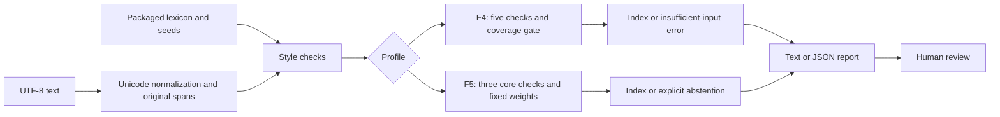

<p align="center"></p>

<p align="center"><b>English</b> · <a href="README.es.md">Español</a></p>

<p align="center">
  <a href="https://github.com/berniehans/textector/actions/workflows/tests.yml"></a>
  <a href="https://github.com/berniehans/textector/releases/latest"></a>
  
  
  <a href="LICENSE"></a>
</p>

<p align="center"><a href="#quick-start">Quick start</a> · <a href="#how-it-works">Architecture</a> · <a href="#evidence-and-limits">Evidence</a> · <a href="docs/README.md">Documentation</a> · <a href="https://github.com/berniehans/textector/releases/tag/v0.3.1">Download 0.3.1</a></p>

**textector** is a local, Spanish-language CLI that turns text style features into an explainable **0–100 heuristic index** (`indice_llm`). It exposes each signal's contribution, reports insufficient evidence, and supports human review of Spanish prose.

> The index describes style. It is **not a probability or proof of authorship**. A low score does not establish human authorship. Version **0.3.1** is published as an experimental prefilter; its external evaluation has substantial limits.

## What you can inspect

| Capability | What it provides |
|---|---|
| **Explainable scoring** | Raw metrics, normalized signals, weights and individual contributions. |
| **Local analysis** | Standard library runtime, no API keys, model downloads or network calls during analysis. |
| **Explicit coverage** | F4 requires all five checks; F5 abstains if any of its three core checks is unavailable. |
| **Two profiles** | Historical F4 by default; an opt-in, frozen experimental F5 profile. |
| **Auditable inputs** | Seed hashes, lexicon fingerprints, corpus provenance and versioned evaluation reports. |
| **Portable package** | A wheel with the lexicon, profile configuration and both seeds included. |

## Quick start

Requires **Python 3.11+**. Install the published wheel directly from GitHub Releases:

```bash
python -m pip install "https://github.com/berniehans/textector/releases/download/v0.3.1/textector-0.3.1-py3-none-any.whl"
textector analyze --archivo texto.txt --detallado
textector analyze --archivo texto.txt --json --diagnostico
```

Use a UTF-8 file and preserve its original paragraphs and punctuation. F4 needs at least 10 eligible sentences, 3 paragraphs, 50 tokens and 150 clean bytes, with all five checks available. See the [usage guide](docs/guia-uso.md) for requirements and errors. Distribution is through GitHub Releases; these commands do not assume a PyPI package.

### Run from source

```bash
git clone https://github.com/berniehans/textector.git
cd textector
uv sync --locked
uv run python -B tools/cli.py analyze --archivo corpus/human/h01.txt
```

Actual output for the repository's `h01.txt` sample:

```text
indice_llm=15 version=f4-integridad n_disponibles=5 semillas=reales-es
```

This demonstrates the report format, not classifier accuracy. `--detallado` expands contributions; `--json` returns the full machine-readable report.

### Other input and profile options

```bash
# Standard input (UTF-8 shell)
cat texto.txt | textector analyze --stdin --json

# Frozen experimental profile; select it explicitly
textector analyze --archivo texto.txt --metodo f5 --json
```

Choose one input source: `--archivo` or `--stdin`. `--diagnostico` describes F4 only and cannot be combined with F5. See the [complete option reference](docs/guia-uso.md#opciones).

## How it works



F4 measures **lexical diversity (MATTR), cliché density, seeded compression, sentence-length variation and paragraph uniformity**. F5 uses the first three with its own fixed weighting; rhythm and paragraph checks remain descriptive auxiliaries.

| Profile | Signal version | Coverage and interpretation |
|---|---|---|
| **F4 · default** | `f4-integridad` | Requires 5/5 checks. Historical provisional reference: 31 ± 2; inclusive abstention band 29–33. |
| **F5 · opt-in** | `f5-portable-v1` | Requires 3/3 core checks. Frozen development threshold: 15 ± 4; inclusive abstention band 11–19. Experimental. |

Package version `0.3.1` and signal versions identify different things. Scores are not interchangeable across F3, F4 and F5. Diagnostic categories remain `no_concluyente=True`. Internal `humano`/`ia` labels are evaluation categories, not authorship verdicts.

Read the [architecture](docs/arquitectura.md), [F4 checks](docs/checks.md) and [F5 definition](docs/validacion-f5-portable.md).

## Evidence and limits

The external F4 evaluation kept its parameters fixed and used existing public texts. No new AI samples were generated for it.

| F4 external panel | Total | AI-style signal | Abstentions |
|---|---:|---:|---:|
| Human books with digital snapshots before 2020 | 90 fragments, 9 authors | **8 false positives (8.9% of all fragments)** | 19 |
| Published Spanish children's stories attributed to Gemini 1.5 Flash | 200 | 190 | 9 |
| Spanish literary generations from IberAuTexTification | 300 | No cases scored | **300: insufficient input structure** |

The panels differ in genre, length and formatting. The human fragments are not 90 independent authors. The result on children's stories does not establish performance on other generators or adult narrative. See [denominators, coverage, provenance and confounders](docs/validacion-externa-v1.md).

**The F5 Spanish narrative research line is closed without promotion.** Development screening found no variant meeting all declared gates, and the corpus audit found no suitable new independent confirmation set. F5 remains a frozen experiment. See the [experimental plan and closeout](docs/plan-experimental-f5-narrativa.md) and [confirmation-corpus audit](docs/auditoria-busqueda-corpus-confirmatorio-f5.md).

## Verification

Release 0.3.1 passed **159 unit tests in each CI matrix job** on Windows and Ubuntu with Python 3.11 and 3.13. The matrix also exercises the CLI, builds the wheel, and verifies its resources, F4/F5 behavior and parity outside the checkout.

```bash
uv run python -B -m unittest discover -s tests -p "test_*.py" -v
uv build --wheel
uv run python -B tests/verify_wheel.py dist/textector-0.3.1-py3-none-any.whl
```

Software checks verify implementation and packaging. They do not establish statistical validity for authorship detection. [CI workflow](.github/workflows/tests.yml) · [release review](docs/revision-lanzamiento-0.3.1.md).

## Repository map

```text
textector/
├── tools/              CLI, text processing, checks and evaluation tools
├── config/             Lexicon and frozen F5 configuration
├── corpus/             Historical manifest, samples and seed provenance
├── validation/         Versioned protocols, reports and permitted metadata
├── tests/              Unit tests and installed-wheel verification
├── docs/               Usage, architecture, evidence and research history
└── assets/             README artwork
```

Third-party texts, downloads and reserved local material are not all distributed in Git or the wheel. Follow the relevant protocol rather than assuming a repository download contains every evaluation corpus.

## Documentation and development

Start with the [documentation index](docs/README.md), [usage guide](docs/guia-uso.md), [architecture](docs/arquitectura.md) and [changelog](CHANGELOG.md). Technical documentation is in Spanish.

For a proposed change, report the profile, package version, input requirements and reproduction steps. Signal or threshold changes require a new signal version and new independent validation data; previously inspected sets cannot serve as fresh confirmation. F3 calibration is retained as an [affected historical record](docs/historico/calibracion-f3.md).

## License and attribution

Code: [MIT](LICENSE). Third-party datasets retain their own licenses and restrictions; see [NOTICE](NOTICE), [corpus provenance](docs/corpus.md) and the corresponding manifests.

Built by [Bernie Hans](https://github.com/berniehans) · [Portfolio](https://berniehans.pages.dev/).
