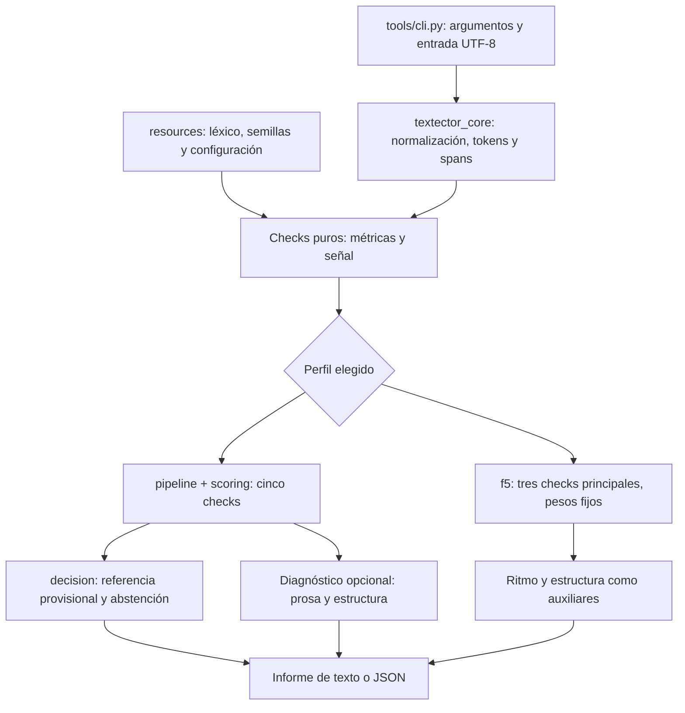

# Arquitectura

[Índice documental](README.md) · [Guía de uso](guia-uso.md) · [Checks F4](checks.md)

El paquete **0.3.1** expone una CLI con dos perfiles de señal: **F4 predeterminado** y **F5 optativo experimental**. Comparten recursos y procesamiento de texto; sus agregaciones y políticas de cobertura están definidas por separado.

## Flujo de análisis

## Responsabilidades

| Módulo | Responsabilidad |
|---|---|
| `tools/cli.py` | Lee entrada y recursos, valida argumentos, elige perfil y presenta el informe. |
| `tools/textector_core.py` | Normaliza Unicode, extrae tokens y conserva spans de segmentación sobre el original. |
| `tools/checks/` | Calcula métricas y señales normalizadas; informa `insufficient` cuando falta evidencia. |
| `tools/pipeline.py` | Orquesta F4 y exige cobertura de cinco checks para emitir índice. |
| `tools/scoring.py` | Agrega señales F4 con pesos y topes históricos; conserva su contrato general de renormalización. |
| `tools/decision.py` | Aplica la referencia histórica provisional F4 31/2 y su banda inclusiva. |
| `tools/f5.py` | Implementa `f5-portable-v1`, denominador fijo y abstención si falta un check principal. |
| `tools/estructura.py`, `tools/diagnostico.py` | Describen estructura y cruzan los dos ejes en el diagnóstico F4. |
| `tools/resources.py` | Resuelve recursos del checkout o incluidos en el wheel. |
| `tools/calibrate.py` | Valida corpus y ejecuta evaluación F4 por grupos sobre TRAIN. |
| `tools/calibrate_f5.py` | Ejecuta calibración de desarrollo del perfil F5. |

## Procesamiento y cobertura

La tokenización aplica NFC, elimina invisibles y usa `casefold`. La segmentación de oraciones conserva spans, descarta cabeceras y trata elipsis de forma conservadora. Los checks trabajan sobre texto procesado; los mínimos de [la guía](guia-uso.md#preparar-la-entrada) no se verifican contando palabras en un editor.

En **F4**, el agregador admite renormalización como operación general, pero el pipeline público exige **5/5 checks**. El CLI rechaza una entrada insuficiente sin emitir índice. Cuando sí puntúa, la referencia provisional 31/2 produce una banda inclusiva 29–33. `--diagnostico` añade una lectura descriptiva de prosa y estructura, siempre no concluyente.

En **F5**, MATTR, clichés y compresión aportan al índice con denominador fijo **1,0**. No se redistribuyen los pesos. Si falta cualquiera, el informe devuelve índice nulo y abstención. Ritmo y párrafos son auxiliares; su insuficiencia no impide puntuar. El umbral de desarrollo congelado es 15/4 y `--diagnostico` no se admite con este perfil.

La investigación narrativa F5 se cerró sin promoción. El código publicado conserva el perfil experimental; la presencia de herramientas de investigación en `tools/` no las convierte en parte del camino de análisis del usuario.

## Recursos y distribución

`importlib.resources` permite cargar léxico, configuración F5 y ambas semillas desde el wheel. El corpus completo y los textos externos no son necesarios para analizar una entrada. Un checkout incompleto falla de forma explícita; no sustituye recursos ausentes por datos inventados. Un léxico externo debe superar validación de esquema y su huella queda registrada.

Los módulos de ejecución usan biblioteca estándar. Hatchling construye el paquete; `uv` facilita desarrollo y reproducción. El análisis no hace llamadas de red. Las herramientas separadas para restaurar corpus sí necesitan descargar sus fuentes públicas cuando se ejecutan expresamente.

## Evaluación y pruebas

`calibrate.py` verifica el manifiesto, reconstruye semillas por fold excluyendo el grupo evaluado y agrega predicciones fuera de muestra con sus denominadores y coberturas. Por defecto usa TRAIN; no evalúa el holdout histórico ni modifica parámetros del CLI. Véanse [evaluación interna](calibration.md) y [evaluación externa limitada](validacion-externa-v1.md).

La CI ejecuta Python 3.11/3.13 en Windows y Ubuntu, prueba la CLI y verifica el wheel instalado fuera del checkout con F4/F5 y recursos incluidos. Esta evidencia certifica los comportamientos ejercitados y el empaquetado; la eficacia de las señales tiene los límites de cada evaluación de corpus.
